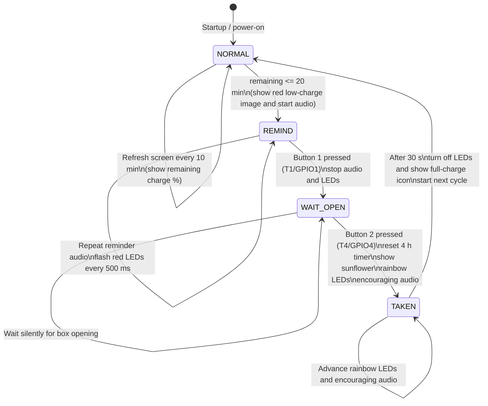

# final — Smart Medication Case: Final Firmware

> ESP32-S3 medication reminder device combining an e-paper display, amplifier, WS2812 LEDs, and touch buttons, with reminders repeating on a four-hour medication cycle.

---

## 1. Application Logic

### State Machine (Flowchart)



> **State-transition summary** (corresponds to `app_step()` in `src/main.cpp`)

| # | From → To | Trigger | Action on entry |
|---|---|---|---|
| 1 | `[*] → NORMAL` | Power-on | Show full-charge icon; `cycle_start_ms = millis()` |
| 2 | `NORMAL → NORMAL` (self-loop) | `now - last_refresh ≥ 10min` | Refresh display with current remaining charge |
| 3 | `NORMAL → REMIND` | `remaining ≤ 20min` | Show red low-charge indicator and start reminder audio |
| 4 | `REMIND → REMIND` (self-loop) | Audio ends and repeats | Toggle red LEDs every 500 ms |
| 5 | `REMIND → WAIT_OPEN` | Button 1 (T1) pressed | Stop audio and LEDs |
| 6 | `WAIT_OPEN → WAIT_OPEN` (self-loop) | Waiting | No output (silent) |
| 7 | `WAIT_OPEN → TAKEN` | Button 2 (T4) pressed | `cycle_start_ms = now` (reset 4 h), sunflower, rainbow LEDs, encouraging audio |
| 8 | `TAKEN → TAKEN` (self-loop) | Encouraging audio not finished | Advance rainbow LEDs |
| 9 | `TAKEN → NORMAL` | `now - state_enter ≥ 30s` | Turn off LEDs and show full-charge icon |

### Core Rules

- One medication cycle lasts **4 h = 240 minutes**.
- Refresh the display **every 10 minutes** with the remaining-charge percentage.
- When **20 minutes or less** remain, trigger spoken and flashing-light reminders.
- **The box must be opened (button 2)** to register medication as taken. Button 1 alone does not reset the timer.
- After medication is taken, reset to full charge and begin the next cycle.

---

## 2. Hardware Connections

| Module | Signal | GPIO | Notes |
|---|---|---|---|
| **E-paper display** | BUSY | 14 | Input |
| | RST | 13 | Output |
| | DC | 9 | Output |
| | CS | 10 | Output |
| | SCK | 12 | SPI clock |
| | MOSI | 11 | SPI data |
| | VCC | 3.3V | **Do not use 5V** |
| **Amplifier** | BCLK | 41 | I2S |
| | LRC | 42 | I2S |
| | DIN | 2 | I2S |
| **WS2812** | DIN | 6 | 9 LEDs |
| **Touch 1** | T1 | 1 | Acknowledge medication |
| **Touch 2** | T4 | 4 | Detect box opening |

---

## 3. Flashing

```bash
cd code/final
pio run -t upload
```

After flashing:
1. The screen shows the full-charge icon (4 h).
2. The serial monitor prints the state machine and help menu.
3. The device enters `NORMAL`.

---

## 4. Serial Debugging Commands (115200 baud)

The four-hour cycle is too long for routine debugging. Use these commands to trigger transitions:

| Command | Function |
|---|---|
| `T` | Trigger reminder immediately (set remaining time to 20 min) |
| `C` | Simulate pressing "confirm medication" |
| `O` | Simulate pressing "open box" |
| `R` | Reset timer to full charge |
| `S` | Display current state |
| `H` | Help |

### Typical Debugging Sequence

```
T   -> REMIND (speaker sounds + red LEDs flash)
C   -> WAIT_OPEN (audio and LEDs stop)
O   -> TAKEN (sunflower + rainbow LEDs + timer reset)
(wait 30 s)
    -> automatically returns to NORMAL (full-charge icon)
```

---

## 5. Directory Structure

```
final/
├── platformio.ini              # PlatformIO configuration (PSRAM + FastLED + LittleFS)
├── partitions.csv              # Custom partition table (3 MB app + 1.5 MB LittleFS)
├── README.md                   # This file
├── data/                       # LittleFS root directory (upload with pio run -t uploadfs)
│   ├── README.txt              # WAV format requirements and upload instructions
│   ├── remind.wav              # Spoken medication reminder (user-provided)
│   └── encourage.wav           # Encouraging audio after medication (user-provided)
└── src/
    ├── main.cpp                # Main program: four-state machine + touch debounce + WAV-first playback
    ├── epd_driver/             # From 07_epd_test (includes ESP32-S3 fixes)
    │   ├── Display_EPD_W21.h   # Adds PIC_display_raw declaration
    │   ├── Display_EPD_W21.cpp # Adds PIC_display_raw implementation (bypasses Color_get)
    │   ├── Display_EPD_W21_spi.h
    │   ├── Display_EPD_W21_spi.cpp
    │   └── Ap_29demo.h         # Official sample image (retained for self-test)
    ├── audio/                  # From 01_audio_record_playback, plus new WAV module
    │   ├── audio_amp.h         # Nonblocking playback API
    │   ├── audio_amp.cpp       # amp_play_async / amp_loop / amp_stop
    │   ├── audio_wav.h         # LittleFS WAV playback
    │   └── audio_wav.cpp       # Parse RIFF header, load to PSRAM, call amp_play_async
    ├── ui/                     # Newly written e-paper UI drawing
    │   ├── ui_draw.h           # Canvas abstraction
    │   └── ui_draw.cpp         # Battery icon, sunflower, circle and rectangle drawing
    └── assets/                 # Square-wave fallback when WAV is unavailable
        ├── voice_remind.h      # Reminder-tone interface
        └── voice_remind.cpp    # Generate square wave at runtime
```

---

## 6. Key Modules

### 6.1 Canvas (`ui_draw`)

The e-paper display lacks a drawing API. This project uses a **4048-byte, 2-bit buffer** as a canvas:

```cpp
Canvas cv;
cv.clear(UI_WHITE);                 // White background
cv.fillCircle(44, 92, 18, UI_BLACK); // Solid black circle
// ... then call PIC_display_raw(cv.buf) to display
```

**Color encoding** (2 bits per pixel): `00` = black; `01` = white; `10` = yellow; `11` = red.

**Key APIs:** `setPixel / fillRect / drawRect / fillCircle / drawCircle`.

### 6.2 `PIC_display_raw` (Added to `epd_driver`)

The official `PIC_display` remaps every pixel using `Color_get` (intended for externally generated image data), making it unsuitable for canvas-generated bitmaps. The new `PIC_display_raw` writes **4048 bytes directly to the screen**, using the same color encoding as `Display_All_*`.

### 6.3 Nonblocking Audio (Added to `audio_amp`)

`amp_play()` blocks until playback ends, whereas the state machine needs nonblocking playback. New functions:

```cpp
amp_play_async(data, samples);  // Start playback and return immediately
amp_loop();                     // Advance playback from the main loop
amp_is_playing();               // Check playback state
amp_stop();                     // Stop playback
```

### 6.4 Voice Playback (LittleFS + WAV Files)

Voice files are stored in the **LittleFS filesystem** (a separate Flash partition), then read and played at runtime. **Audio can be replaced without recompiling the firmware.**

#### Supported Files

| File | Purpose | If Missing |
|---|---|---|
| `/remind.wav` | Medication reminder, repeated in `REMIND` | Fall back to triple-beep square wave |
| `/encourage.wav` | Encouragement, played once in `TAKEN` | Fall back to a short square wave |

#### WAV Requirements

- PCM (uncompressed)
- **16 kHz** sample rate
- **16-bit** depth
- Mono preferred; stereo automatically uses the left channel

#### Upload WAV Files to LittleFS

1. Place `remind.wav` and `encourage.wav` in `data/`.
2. Run:

```bash
pio run -t uploadfs
```

This builds a LittleFS image and flashes it to the 1.5 MB partition labeled `spiffs`.

#### First-Run Check

Expected serial output:

```
[WAV] mounting LittleFS...
[WAV] LittleFS mounted: total=1536KB used=120KB
[WAV] files in /:
  /remind.wav (96044 bytes)
[INIT] /remind.wav found, using WAV playback
```

If LittleFS was not uploaded or the file is missing, the system falls back to a square wave:

```
[INIT] /remind.wav NOT found, fallback to beep
```

#### Generating WAV Files

```bash
# Convert MP3 to 16 kHz mono WAV
ffmpeg -i input.mp3 -ar 16000 -ac 1 -ab 16 -f wav remind.wav
```

Alternatively, use Audacity: File > Export as WAV > select 16-bit PCM > set sample rate to 16000.

### 6.5 Placeholder Voice (`assets/voice_remind`)

**Fallback:** If LittleFS has not been uploaded or `/remind.wav` is missing, the firmware generates three 800 Hz square-wave beeps with silence between them (1.8 s total). Useful for debugging and verifying the first flash.

### 6.5 Touch-Button Debouncing

```cpp
// touchRead < TOUCH_THRESHOLD (30) is considered pressed
// Trigger only once per button within 300 ms (debounce)
bool touch_pressed(int pin, uint32_t& last_trig_ms);
```

---

## 7. Parameter Tuning (Macros at Top of `src/main.cpp`)

| Parameter | Default | Description |
|---|---|---|
| `FULL_CHARGE_MIN` | 240 | Full-charge time in minutes (4 h) |
| `REFRESH_INTERVAL_MIN` | 10 | Screen refresh interval |
| `REMIND_THRESHOLD_MIN` | 20 | Reminder threshold |
| `TAKEN_HOLD_MS` | 30000 | Duration of `TAKEN` state |
| `TOUCH_THRESHOLD` | 30 | Touch activation threshold |
| `TOUCH_DEBOUNCE_MS` | 300 | Button debounce interval |

**Accelerated testing:** Set `FULL_CHARGE_MIN` to 4 and `REMIND_THRESHOLD_MIN` to 1 to run through the entire state machine in under 10 minutes.

---

## 8. Resource Usage

- **RAM: 25.2%** (82,728 / 327,680 bytes)
  - 56 KB voice buffer + 4 KB canvas + FastLED buffer
- **Flash: 9.7%** (324,637 / 3,342,336 bytes)

---

## 9. Relationship to Other Projects

| Project | Reused Components |
|---|---|
| `01_audio_record_playback` | `audio_amp.h/.cpp`, with new nonblocking API |
| `06_ws2812_test` | FastLED configuration and blink/rainbow functions |
| `07_epd_test` | Five `epd_driver/` files, including ESP32-S3 fixes |

---

## 10. Known Limitations and Possible Extensions

| Item | Current Status | Future Improvement |
|---|---|---|
| Voice | Placeholder square wave | Replace with real WAV recording |
| Time reference | Accumulated `millis()` (lost on power failure) | Add RTC or NTP synchronization |
| Power consumption | Runs continuously | Sleep and timed wake-up (needed for battery operation) |
| E-paper reset | POF replaces DeepSleep (fix from module 07) | Repair hardware before production and restore DeepSleep |
| Tremor detection | Not integrated | Optionally integrate module 03 |
| Data reporting | None | Report medication records via Wi-Fi/BLE |

---

## 11. Debugging Recommendations

1. **First flash:** Check that the screen displays the battery icon (verify SPI connection).
2. **Send `T`:** Reminder audio and flashing LEDs should start (verify I2S and FastLED).
3. **Send `C`:** Audio and LEDs should stop.
4. **Send `O`:** Sunflower, rainbow LEDs, and timer reset should appear.
5. **Test touch pads:** Touch GPIO1/GPIO4 pads and inspect `[TOUCH]` serial logs.
6. **Tune `TOUCH_THRESHOLD`:** Adjust based on observed response; 30 is empirical and varies by PCB.
